<!-- Profile README of Nabin Babu Uranw. Assets live in ./assets; no scripts, no tracking. -->

<picture>
  <source media="(prefers-reduced-motion: reduce)" srcset="./assets/nabin-hero-static.svg">
  
</picture>

 

I'm Nabin, an independent full-stack developer and UI/UX designer from Inaruwa, in Sunsari, Nepal. I design and build web products for the people around me: clinics, shops, schools and small businesses, and I'm making an open-world game set on the streets of my own town.

Most of the work below is live: open it, click around, read the code.

 

### Selected work

| Project | What it is | Links |
| :-- | :-- | :-- |
| **Veerbhumi** (वीरभूमि) Godot 4 · GDScript | An open-world game prototype set in Nepal, with a real Inaruwa–Itahari corridor built from OpenStreetMap data. Playable in the browser. | [Play](https://nabinbabuuranw.github.io/veerbhumi/) · [Code](https://github.com/nabinbabuuranw/veerbhumi) |
| **Basta** (बस्ता) React · TypeScript · Cloudflare Workers · D1 | Fees, roll call, notices and report cards for small private schools, with separate logins for the office, teachers and parents. | [Live](https://basta-school.sites.tab.bot/) · [Code](https://github.com/nabinbabuuranw/basta) |
| **Chukta** (चुक्ता) React · TypeScript · Cloudflare Workers | VAT-ready bills and receivables for Nepali small businesses. | [Live](https://chukta.sites.tab.bot/) · [Code](https://github.com/nabinbabuuranw/chukta) |
| **Kotha** (कोठा) React · TypeScript · Cloudflare Workers | Rooms and flats to rent in the Kathmandu Valley, plus a rent book for landlords and tenants. | [Live](https://kotha-ktm.sites.tab.bot/) · [Code](https://github.com/nabinbabuuranw/kotha) |
| **NEXA** Web platform · in progress | The website for NEXA, my music distribution startup for independent artists. Pre-launch. | [Live](https://nexa.sites.tab.bot/) |
| **AAMA Collection** Online store | An online shop for a saree and kurtha store in Inaruwa, with its own admin panel. | [Live](https://aama-collection.sites.tab.bot/) |

Basta, Chukta and Kotha are part of a series of small platforms I'm building one after another; the first was [Palo](https://palo.sites.tab.bot/), appointment booking for clinics and salons.

 

### Tools I use

| | |
| :-- | :-- |
| **Languages** | TypeScript · JavaScript · Python · GDScript · HTML · CSS |
| **Frontend** | React · Next.js · Vite · Tailwind CSS · Framer Motion · GSAP |
| **Backend & data** | Cloudflare Workers · Cloudflare D1 · Prisma · Zod · Clerk (auth) · Resend (email) |
| **Games** | Godot 4 |
| **Design** | UI/UX design · design systems · responsive layouts |

 

### Contributions

Live contribution data from GitHub, drawn by ghchart.

 

### Find me

**Portfolio** · [nabinbabuuranw.sites.tab.bot](https://nabinbabuuranw.sites.tab.bot/) 
**Email** · [nabinuranw333@gmail.com](mailto:nabinuranw333@gmail.com) 
**Based in** · Inaruwa, Sunsari, Nepal

 

