<!-- Generated assets in /assets: text is drawn as outlined paths (Instrument Serif and JetBrains Mono, SIL OFL), icons are Simple Icons (CC0). Animation is SMIL inside SVG, no scripts, no tracking. Static twins are served to people who prefer reduced motion. -->

<picture>
  <source media="(max-width: 600px) and (prefers-reduced-motion: reduce)" srcset="./assets/hero-m-static.svg">
  <source media="(prefers-reduced-motion: reduce)" srcset="./assets/hero-static.svg">
  <source media="(max-width: 600px)" srcset="./assets/hero-m.svg">
  
</picture>

 

<picture>
  <source media="(prefers-reduced-motion: reduce)" srcset="./assets/sec-1-static.svg">
  
</picture>

I'm Nabin, an independent full-stack developer and UI/UX designer from Inaruwa, in Sunsari, Nepal. I design and build web products for the people around me: schools, shops, clinics and small businesses. Right now I'm also building an open-world game set on the streets of my own town.

I care about the unglamorous parts that make software usable in Nepal: Bikram Sambat dates, Nepali and English interfaces, bills that handle VAT, and roles and permissions that keep one school's data away from another's. Most of what's below is live or open source, so you can click around and read the code.

 

<picture>
  <source media="(prefers-reduced-motion: reduce)" srcset="./assets/sec-2-static.svg">
  
</picture>

<a href="https://github.com/nabinbabuuranw/school-management-system"><picture>  <source media="(prefers-reduced-motion: reduce)" srcset="./assets/card-sms-static.svg">  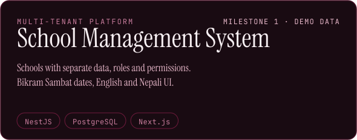</picture></a>
<a href="https://github.com/nabinbabuuranw/veerbhumi"><picture>  <source media="(prefers-reduced-motion: reduce)" srcset="./assets/card-veerbhumi-static.svg">  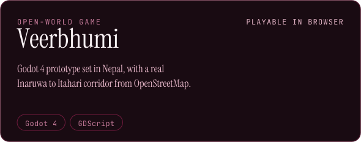</picture></a>
<a href="https://github.com/nabinbabuuranw/basta"><picture>  <source media="(prefers-reduced-motion: reduce)" srcset="./assets/card-basta-static.svg">  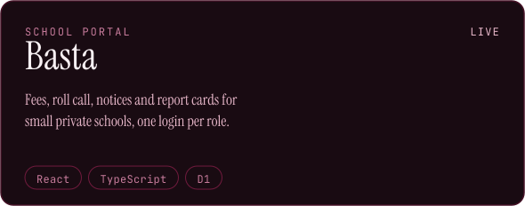</picture></a>
<a href="https://github.com/nabinbabuuranw/byawastha"><picture>  <source media="(prefers-reduced-motion: reduce)" srcset="./assets/card-byawastha-static.svg">  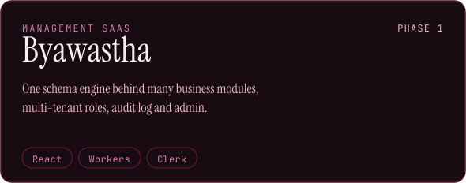</picture></a>
<a href="https://github.com/nabinbabuuranw/chukta"><picture>  <source media="(prefers-reduced-motion: reduce)" srcset="./assets/card-chukta-static.svg">  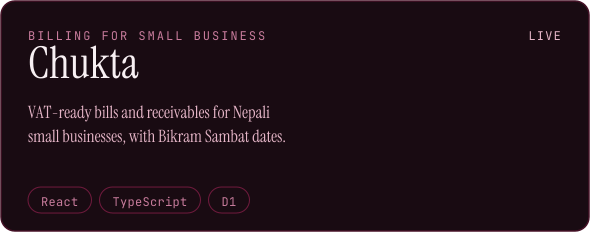</picture></a>
<a href="https://github.com/nabinbabuuranw/kotha"><picture>  <source media="(prefers-reduced-motion: reduce)" srcset="./assets/card-kotha-static.svg">  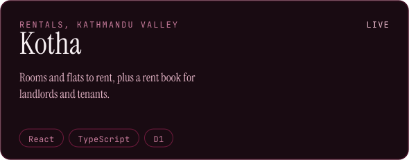</picture></a>

<b>Open the work</b> &nbsp; [Veerbhumi, play in browser](https://nabinbabuuranw.github.io/veerbhumi/) · [Basta, live](https://basta-school.sites.tab.bot/) · [Chukta, live](https://chukta.sites.tab.bot/) · [Kotha, live](https://kotha-ktm.sites.tab.bot/)

<b>Also</b> &nbsp; [Palo](https://github.com/nabinbabuuranw/palo), appointment booking for clinics and salons · [Nepali Date](https://github.com/nabinbabuuranw/nepali-date), a Bikram Sambat converter · [IEBS](https://github.com/nabinbabuuranw/iebs), a school website with admin · [AAMA Collection](https://aama-collection.sites.tab.bot/), an online saree and kurtha store · NEXA, a music distribution startup, pre-launch

 

<picture>
  <source media="(prefers-reduced-motion: reduce)" srcset="./assets/sec-3-static.svg">
  
</picture>

<picture>
  <source media="(max-width: 600px) and (prefers-reduced-motion: reduce)" srcset="./assets/stack-m-static.svg">
  <source media="(prefers-reduced-motion: reduce)" srcset="./assets/stack-static.svg">
  <source media="(max-width: 600px)" srcset="./assets/stack-m.svg">
  
</picture>

Only tools that appear in the repositories above.

 

<picture>
  <source media="(prefers-reduced-motion: reduce)" srcset="./assets/sec-4-static.svg">
  
</picture>

Live from GitHub via ghchart. My account is new and most of this work landed in the last few days, so the graph is young.

 

<picture>
  <source media="(prefers-reduced-motion: reduce)" srcset="./assets/sec-5-static.svg">
  
</picture>

<b>Portfolio</b> &nbsp; [nabinbabuuranw.sites.tab.bot](https://nabinbabuuranw.sites.tab.bot/) 
<b>Email</b> &nbsp; [nabinuranw333@gmail.com](mailto:nabinuranw333@gmail.com) 
<b>Based in</b> &nbsp; Inaruwa, Sunsari, Nepal

 

<picture>
  <source media="(prefers-reduced-motion: reduce)" srcset="./assets/footer-static.svg">
  
</picture>
